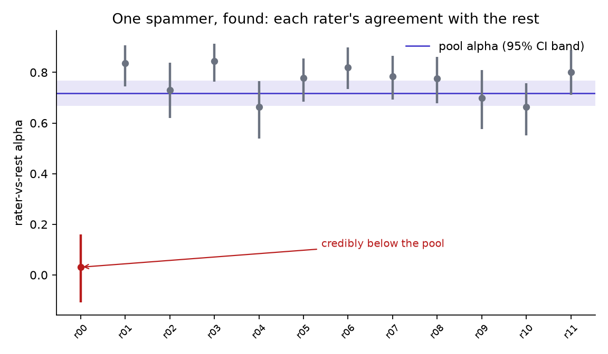
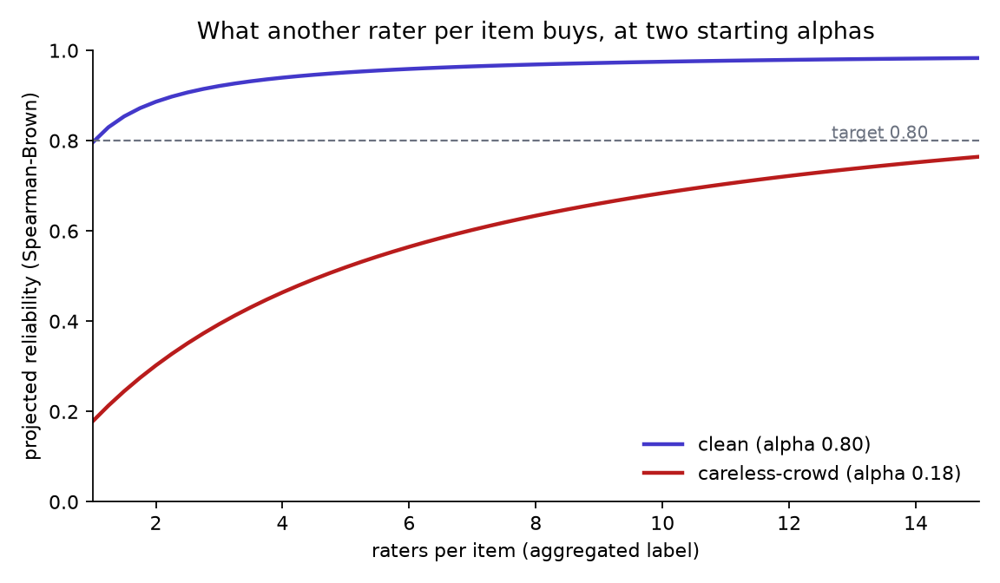

# raterkit

Audit a labeled dataset before you trust it.

[](https://github.com/mohammadi-hadi/raterkit/actions/workflows/ci.yml)

Every benchmark score, every fine-tune, every "our judge agrees with humans
92% of the time" bottoms out in a pile of human labels — produced by raters
who may have been careless, biased, tired by the end of the queue, or graded
against gold that was quietly wrong. None of that is visible in accuracy
numbers computed on top. raterkit reads the raw ratings and measures each of
these failure modes directly, with a confidence interval on every number and
a flag only when the evidence clears a stated bar.

## The audit in one table

Eight synthetic annotation projects, seven implanted defects. Bold values are
flags; each lands on the row where its defect was implanted, and the clean
row carries none.

<!-- raterkit:demo -->
| project | implanted defect | alpha | rogue | biased | drift gap | leaks | stale gold | flags |
|---|---|---|---|---|---|---|---|---|
| clean | nothing | 0.80 | 0 | 0 | +0.00 | 0 | 0.0% | none |
| careless-crowd | every rater at 55% accuracy | **0.18** | 0 | 0 | -0.02 | 0 | 0.7% | reliability |
| one-spammer | one rater answers uniformly at random | 0.72 | **1** | 0 | +0.05 | 0 | 0.0% | rogue raters |
| leaning-rater | one rater always takes the same side of ambiguous items | 0.65 | 0 | **1** | +0.05 | 0 | - | rater bias |
| tiring-crowd | competence decays 0.97 to 0.73 over the queue | 0.64 | 0 | 0 | **+0.25** | 0 | 0.0% | drift |
| leaky-split | 12 test items duplicate a train item's text | 0.80 | 0 | 0 | +0.00 | **12** | 0.0% | split leakage |
| stale-gold | 8% of gold labels are wrong | 0.80 | 0 | 0 | +0.00 | 0 | **6.7%** | stale gold |
| easy-but-skewed | 94% of items are one class; raters 90% accurate | **0.34** | 0 | 0 | +0.12 | 0 | 0.0% | reliability |
<!-- /raterkit:demo -->

The row to sit with is `easy-but-skewed`: raters are 90% accurate and agree
with each other 81% of the time, yet alpha is 0.34 — far below the 0.667
floor. With 94% of items in one class, raters agree that often by accident;
the skew, not the raters, is doing the agreeing. Raw agreement percentages
cannot be compared across datasets with different label distributions, which
is why every agreement number here is chance-corrected.





`make demo` regenerates the table, the [full report](results/report.md) and
the figures from fixed seeds; CI rebuilds them from pinned dependencies and
fails if a committed number differs from what the code produces.

## 211,225 real ratings, audited

[`examples/goemotions/`](examples/goemotions/) audits the raw crowd ratings
behind [GoEmotions](https://aclanthology.org/2020.acl-main.372/) — 211,225
ratings by 82 raters over 58,011 Reddit comments, 28 binary emotion labels
each. Committed results:
[examples/goemotions/results/goemotions.md](examples/goemotions/results/goemotions.md).

- **27 of 28 emotions sit below the 0.667 reliability floor** — the whole
  95% CI, not just the point estimate. Only *gratitude* (alpha 0.72) passes;
  the median emotion manages 0.23, and *neutral* itself scores 0.26.
- **Rater quality spans 0.11 to 0.36** (rater-vs-rest alpha across the 67
  raters with 300+ ratings) — the noisiest raters agree with their co-raters
  at a third of the rate the best ones do, and 20 of 67 sit below 0.20.
- **The rater count was never enough for the task.** By Spearman-Brown, the
  observed reliability would need ~13 raters per item to yield 0.8-reliable
  aggregated labels; the dataset averages 3.6, which projects to 0.52.
- 86% of multi-rated comments are contested on at least one emotion, yet
  raters marked only 1.6% of ratings "very unclear" — disagreement without
  awareness of disagreement.

None of this says GoEmotions is a scandal — fine-grained emotion is
genuinely hard, and the released splits aggregate and filter these raw
ratings. It says the raw layer under a famous benchmark fails the standard
reliability bar almost everywhere, measurably and reproducibly.

## Install

```
pip install git+https://github.com/mohammadi-hadi/raterkit
```

Python 3.11+. Runtime dependencies: numpy, pydantic, matplotlib.

## Quickstart

Log one JSON object per rating — who labeled what, and optionally when, in
which split, and the item text:

```json
{"item_id": "c41", "rater_id": "r07", "label": "toxic", "t": 1718040000, "split": "train", "text": "..."}
```

```python
from raterkit import load_ratings, load_gold, run_audit

audit = run_audit(load_ratings("ratings.jsonl"), gold=load_gold("gold.jsonl"))
for flag in audit.flags:
    print(flag.name, "--", flag.detail)
```

Or from the shell, with an exit code CI can gate on:

```
raterkit report ratings.jsonl --gold gold.jsonl --out audit --fail-on-flags
```

An optional config sets the measurement level (`nominal`, `ordinal`,
`interval`), the label order, and the target reliability. Alongside
`report.md` the audit writes `report.json` for pipelines that gate on
specific numbers. Any check that could not run is listed with the exact
fields to log to enable it — a skip describes the log file, not the raters.

An LLM judge is just another rater: give its verdicts a `rater_id` and the
same audit reports how it agrees with the humans, whether its label
distribution diverges, and whether it drifts — no special casing needed.

## What it checks

| check | question it answers | needs |
|---|---|---|
| reliability | is agreement above the chance-corrected floor? | 2+ ratings on some items |
| rogue raters | does any rater agree with the rest credibly less than the pool? | 30+ pairs per rater |
| rater bias | does any rater use the labels differently (marginal shift)? | 30+ ratings per rater |
| drift | did agreement change between early and late work? | `t` per rating |
| split leakage | does any duplicated text span train/test? | `text` + `split` |
| stale gold | which gold labels does a unanimous crowd contradict? | a gold file |
| ambiguity | how many items are genuinely contested? | 2+ ratings on some items |
| prevalence | is raw agreement inflated by class skew? | always runs |
| rating depth | how many raters per item does your target reliability need? | always runs |

The last three are descriptive and never flag: they explain the numbers
above them.

## How the numbers are defended

- **Cross-checked implementations.** Krippendorff's alpha (nominal, ordinal
  and interval, with missing data) matches the reference `krippendorff`
  package to 1e-10; Cohen's and Fleiss' kappa match statsmodels; the
  chi-square survival function matches scipy to 1e-10; Benjamini-Hochberg
  reproduces statsmodels decisions exactly. The library itself depends on
  none of them.
- **Validation by implantation.** The synthetic projects have defect dials —
  a spammer, a leaning rater, a competence drift, a gold error rate — and
  the tests require each probe to recover its dial, stay monotone in it, and
  stay silent on the clean project.
- **Uncertainty on every number.** Band probes trigger only when the whole
  95% bootstrap CI leaves the innocent band; the bootstrap resamples items
  (never single ratings), so dependence within an item is respected.
- **Drift-checked results.** The demo table, report and README numbers are
  regenerated by CI from pinned dependencies and diffed against the
  committed copy.

## Design notes

- **Chance correction is not optional.** The `easy-but-skewed` demo row and
  the kappa-paradox literature both show raw agreement rewarding class skew.
  All agreement numbers are Krippendorff's alpha, which handles missing
  ratings, any number of raters, and nominal/ordinal/interval labels in one
  framework — and reduces to the familiar coefficients where they overlap.
- **Innocent bands, not point nulls.** With enough data any rater's marginal
  "significantly" differs from the pool's while meaning nothing. Band probes
  state the interval a healthy project could occupy (bias within 0.10 total
  variation, drift within ±0.10 alpha) and flag only when the whole CI
  leaves it. Exact procedures use conventions: the 0.667 floor, zero
  tolerance for cross-split duplicates. All constants live in one place
  ([`probes.py`](src/raterkit/probes.py)) and are easy to disagree with.
- **Raters are compared to the pool, not to a standard.** A rater is rogue
  when their CI sits below the pool's CI — a claim about this project, not
  about an absolute bar their domain may not share.
- **Ambiguity is measured, not punished.** Contested items are reported
  descriptively: persistent disagreement can be signal about the task, not
  noise from the raters, and deserves a number rather than a flag.
- **Deterministic to the digit.** Seeded PCG64 everywhere, no BLAS in any
  statistic's path: the same ratings file gives the same report on any
  machine.

## Limitations

- An audit is bounded by what was logged. No timestamps, no drift check; no
  text or splits, no leakage check; no gold, no gold check.
- The innocent bands and the 0.667 floor are conventions, not derivations;
  fields differ, and the constants are one file away.
- Spearman-Brown projections assume added raters behave like existing ones —
  an optimistic bound, stated as such in the report.
- The rogue-rater comparison needs overlap; raters who never co-rate an item
  with others cannot be tested and are counted as untested, not innocent.
- Implantation shows the probes detect the mechanisms simulated; real
  annotation projects can fail in ways not simulated here.
- The GoEmotions audit measures the raw rating layer; the released benchmark
  splits aggregate and filter it, so per-label alpha here is not a direct
  statement about scores computed on those splits.

## Related work

The failure modes measured here are the standard ones from the agreement and
annotation-quality literature: agreement coefficients and their proper use
([Artstein & Poesio, 2008](https://doi.org/10.1162/coli.07-034-R2);
Krippendorff, *Content Analysis*), interpretation benchmarks
([Landis & Koch, 1977](https://doi.org/10.2307/2529310)), the kappa paradox
under skewed prevalence
([Feinstein & Cicchetti, 1990](https://doi.org/10.1016/0895-4356(90)90158-L)),
crowd label quality ([Snow et al., 2008](https://aclanthology.org/D08-1027/)),
learning rater competence
([Raykar et al., 2010](https://jmlr.org/papers/v11/raykar10a.html)),
annotation error detection
([Klie et al., 2023](https://doi.org/10.1162/coli_a_00464)), and human label
variation as signal
([Plank, 2022](https://aclanthology.org/2022.emnlp-main.731/)). The case
study audits the GoEmotions raw ratings
([Demszky et al., 2020](https://aclanthology.org/2020.acl-main.372/)).
raterkit's contribution is packaging the checks as one auditable tool with
uncertainty on every number and validation by implantation.

Companion projects: [judgekit](https://github.com/mohammadi-hadi/judgekit)
audits LLM judges the way this audits human raters;
[judgepanel](https://github.com/mohammadi-hadi/judgepanel) estimates how
accurate a panel of judges is when no gold labels exist at all;
[abkit](https://github.com/mohammadi-hadi/abkit) applies the same
audit-before-you-trust pattern to A/B-test readouts;
[trajectory-judge](https://github.com/mohammadi-hadi/trajectory-judge)
measures what outcome-only judges miss on agent trajectories.

## Citation

If raterkit is useful in your work, please cite it (see
[CITATION.cff](CITATION.cff)):

```bibtex
@software{mohammadi_raterkit,
  author  = {Mohammadi, Hadi},
  title   = {raterkit: audit a labeled dataset before you trust it},
  url     = {https://github.com/mohammadi-hadi/raterkit},
  version = {0.1.0},
  year    = {2026}
}
```

## License

MIT
