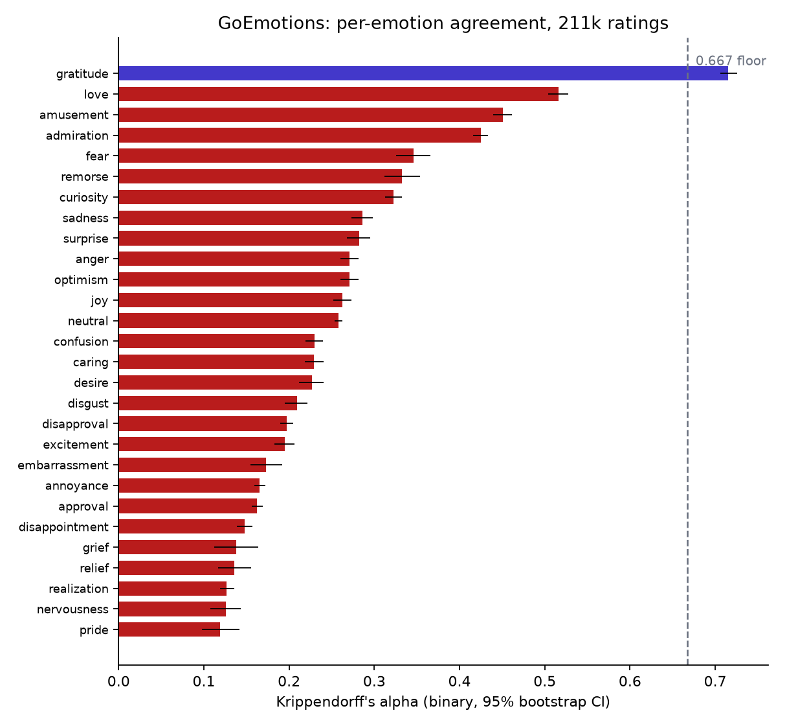

# GoEmotions, audited

211,225 ratings, 58,011 comments, 82 raters, 3.6 ratings per comment. Each of the 28 emotions audited as a binary labeling task.

- **27 of 28 emotions** have a 95% CI entirely below the 0.667 reliability floor; the median per-emotion alpha is **0.23**.
- Best: gratitude (0.72), love (0.52), amusement (0.45). Worst: pride (0.12), nervousness (0.13), realization (0.13).
- Pooled over all 28 binary decisions, alpha = **0.27** (95% CI 0.27-0.27).
- Rater-vs-rest alpha spans **0.11 to 0.36** across the 67 raters with 300+ ratings; 20 of them sit below 0.20. (At 211k ratings the pooled CI is so tight that 'credibly below the pool' only means below average — the range is the honest statistic here.)
- 86% of multi-rated comments are contested on at least one emotion; raters marked 1.6% of ratings 'very unclear'.
- 195 duplicated texts appear under 527 different item ids.
- Spearman-Brown: at the median alpha, reaching 0.8 reliability would take ~13 raters per item; at the actual 3.6, the aggregated label projects to 0.52.

Regenerate: `make goemotions` (downloads ~43 MB, not redistributed here).
